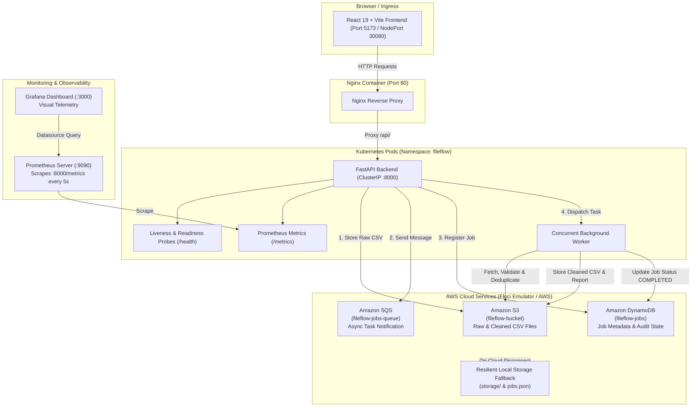

# ☸️ FileFlow: Kubernetes-Orchestrated End-to-End DevOps Platform with AWS Service Integration

[](https://kubernetes.io)
[-FF9900.svg?style=flat-square&logo=amazon-aws&logoColor=white)](https://aws.amazon.com)
[](https://www.docker.com)
[](https://github.com/features/actions)
[](https://www.aquasec.com/products/trivy/)
[](https://prometheus.io)
[](https://fastapi.tiangolo.com)
[](https://react.dev)

> **A production-ready Cloud-Native DevOps Engineering Project** showcasing container orchestration with **Kubernetes**, cloud service integration with **AWS** (S3, SQS, DynamoDB via Floci emulator), automated **Docker** multi-stage builds, continuous integration & security scanning with **GitHub Actions & Trivy**, and real-time **Prometheus & Grafana** observability.

---

## 📖 About the Project

### **FileFlow**
**Automated file validation and processing system**

> **Upload CSV files, validate their contents, process valid files in the background, and store reports. Use S3 for files and SQS for processing tasks.**

FileFlow is engineered as an end-to-end, resilient data processing pipeline designed according to modern cloud-native DevOps principles. When a user uploads a CSV dataset, FileFlow leverages **Amazon S3** for secure raw file retention, pushes processing events to **Amazon SQS** to decouple work queues, distributes asynchronous validation tasks across worker pools, evaluates records against comprehensive data-quality rules, stores audit history in **Amazon DynamoDB**, and exposes live operational telemetry via **Prometheus**.

---

## 📑 Table of Contents

- [1. DevOps & Cloud Infrastructure (First)](#1-devops--cloud-infrastructure)
  - [Kubernetes Orchestration (K8s)](#-kubernetes-orchestration-k8s)
  - [AWS Cloud Architecture (S3, SQS, DynamoDB)](#-aws-cloud-architecture)
  - [Docker & Containerization](#-docker--containerization)
  - [CI/CD Pipeline & Trivy Security Scanning](#-cicd-pipeline--security-scanning)
  - [Monitoring & Observability (Prometheus & Grafana)](#-monitoring--observability)
- [2. System Architecture Diagram](#2-system-architecture-diagram)
- [3. Application Stack](#3-application-stack)
  - [Backend (FastAPI)](#-backend-fastapi)
  - [Frontend (React + Vite)](#-frontend-react--vite)
- [4. Project Directory Structure](#4-project-directory-structure)
- [5. Getting Started & Deployment Guide](#5-getting-started--deployment-guide)
  - [Deploying to Kubernetes](#1-deploying-to-kubernetes-recommended)
  - [Running the Monitoring Stack (Prometheus & Grafana)](#2-deploying-monitoring-stack)
  - [Running with Docker](#3-running-with-docker)
  - [Local Development Setup](#4-local-development-setup)
- [6. API Endpoints](#6-api-endpoints)
- [7. Configuration & Environment Variables](#7-configuration--environment-variables)

---

## 1. DevOps & Cloud Infrastructure

The core foundation of FileFlow is built on enterprise DevOps best practices, cloud-native orchestration, container security, and deep observability:

### ☸️ Kubernetes Orchestration (K8s)
All components are declaratively managed inside the dedicated `fileflow` namespace ([`k8s/`](k8s/)):
- **Namespaces (`namespace.yaml`)**: Isolates FileFlow workloads into a dedicated logical cluster environment.
- **Deployments & Pod Lifecycle**:
  - `api-deployment.yaml`: FastAPI backend deployment with defined CPU/memory limits (`requests: 100m/128Mi`, `limits: 500m/256Mi`).
  - `worker-deployment.yaml`: Background processing worker deployment running task queues.
  - `frontend-deployment.yaml`: High-availability Nginx web frontend.
- **Probes for High Availability**:
  - **Liveness Probes**: Configured on `/health` (period: 10s, initial delay: 5s) to automatically restart unhealthy containers.
  - **Readiness Probes**: Configured on `/health` (period: 5s, initial delay: 3s) to ensure traffic is only routed to fully initialized pods.
- **Services & Ingress Networking**:
  - `api-service.yaml`: Internal `ClusterIP` service exposing port `8000`.
  - `frontend-service.yaml`: `NodePort` service exposing port `30080` for external browser access.
- **Decoupled Configurations**:
  - `configmap.yaml`: Centralized environment configurations (`FLOCI_ENDPOINT_URL`, bucket names, queue names, regions).
  - `secret.yaml`: Secure credential injection for cloud services.

### ☁️ AWS Cloud Architecture
FileFlow interacts with AWS services (via the local **Floci** AWS emulator on port `4566` or live AWS):
- **Amazon S3 (`fileflow-bucket`)**:
  - Stores incoming raw uploaded CSV datasets under `raw/{job_id}/`.
  - Persists cleaned, deduplicated CSV artifacts under `cleaned/{job_id}/`.
  - Saves generated JSON audit reports under `reports/{job_id}/`.
- **Amazon SQS (`fileflow-jobs-queue`)**:
  - Asynchronous message broker that receives task notifications upon file ingestion (`{"job_id": "...", "filename": "..."}`).
  - Decouples file intake from heavy validation and deduplication workloads.
- **Amazon DynamoDB (`fileflow-jobs`)**:
  - Scalable NoSQL table tracking job state transitions (`QUEUED` ➔ `PROCESSING` ➔ `COMPLETED` / `FAILED`), record metrics, processing duration, and error breakdowns.
- **Resilient Fallback Mode**: If cloud endpoints are temporarily offline or undergoing maintenance, FileFlow automatically falls back to an embedded, thread-safe local filesystem and JSON storage engine (`storage/`) with zero downtime.

### 🐳 Docker & Containerization
- **Backend API (`docker/Dockerfile.api`)**:
  - Lightweight, secure `python:3.11-slim` base image.
  - Non-root package caching, decoupled dependency layers, and bundled `curl` healthcheck tools.
- **Frontend SPA (`docker/Dockerfile.frontend`)**:
  - **Multi-Stage Build**:
    - *Stage 1 (Builder)*: `node:20-alpine` installs dependencies and compiles the optimized production bundle (`npm run build`).
    - *Stage 2 (Runtime)*: `nginx:alpine` serves static assets with minimal footprint and zero unnecessary build tools.
- **Nginx Reverse Proxy (`docker/nginx.conf`)**:
  - Proxies all `/api/` traffic to the backend service (`http://fileflow-api-service:8000`).
  - Proxies `/health` healthchecks directly to backend endpoints.
  - Handles client-side Single Page Application (SPA) routing with `try_files $uri $uri/ /index.html`.

### 🔄 CI/CD Pipeline & Security Scanning
Automated with **GitHub Actions** in [`.github/workflows/ci-cd.yml`](.github/workflows/ci-cd.yml) with 3 automated quality gates:
1. **Stage 1: Automated Testing & Build Validation**:
   - Python 3.11 environment setup with pip caching.
   - Comprehensive unit and integration test suite execution with `pytest`.
   - Node.js 20 environment setup and production bundle check (`npm ci && npm run build`).
2. **Stage 2: Container Image Build & Security Vulnerability Scanning**:
   - Uses `docker/setup-buildx-action` to build container images (`fileflow-api` and `fileflow-frontend`).
   - Runs **Aqua Security Trivy** vulnerability scanner (`aquasecurity/trivy-action`) to detect `CRITICAL` and `HIGH` CVEs in container base layers and packages.
3. **Stage 3: Declarative Kubernetes Manifest Validation**:
   - Sets up `kubectl` (v1.29.0).
   - Runs client-side dry-run validation (`kubectl apply --dry-run=client -f k8s/`) across all application, Prometheus, and Grafana manifests to catch syntax or spec regressions prior to deployment.

### 📊 Monitoring & Observability
- **Prometheus Metric Instrumentation**:
  - Integrated via `prometheus-client` in FastAPI.
  - Custom metrics exposed on `/metrics`:
    - `fileflow_http_requests_total`: Counter tracking method, endpoint, and HTTP status codes.
    - `fileflow_http_request_duration_seconds`: Latency histograms measuring response times.
- **Prometheus Deployment (`monitoring/prometheus/`)**:
  - Prometheus server deployed in the `fileflow` namespace with a custom ConfigMap scraping the API pod every 5 seconds.
- **Grafana Visualization (`monitoring/grafana/`)**:
  - Grafana dashboard deployment pre-configured with an automated Prometheus data source (`grafana-datasource.yaml`).

---

## 2. System Architecture Diagram



---

## 3. Application Stack

Following the DevOps infrastructure layer, FileFlow runs a decoupled backend and frontend:

### ⚙️ Backend (FastAPI)
- **Framework**: **FastAPI** (`v0.110.0`) on Python 3.11 with asynchronous ASGI architecture.
- **Server**: **Uvicorn** (`uvicorn[standard]>=0.28.0`).
- **Data Engineering**: **Pandas** (`>=2.2.0`) for vectorized dataset loading, dynamic delimiter sniffing, schema conformance checking, and duplicate purging.
- **Multipart Ingestion**: `python-multipart` streaming file uploads up to 10MB.
- **AWS SDK**: `boto3` (`>=1.34.0`) with custom low-latency timeout configurations (`FAST_BOTO_CONFIG`) for responsive Floci integration.
- **Validation Engine (`validator_service.py`)**:
  - Missing and null value checks (`""`, `null`, `nan`, `undefined`, `n/a`).
  - Strict RFC-compliant regex validation on email addresses.
  - Numerical sanity checks (disallows negative values on amounts, prices, quantities, ages).
  - ISO 8601 & common timestamp format validation.
  - Automatic de-duplication and leading/trailing whitespace trimming.
- **Background Worker (`csv_worker.py`)**:
  - `ThreadPoolExecutor` worker dispatching background jobs concurrently.
- **Testing**: `pytest` and `httpx.TestClient` for test automation.

### 💻 Frontend (React + Vite)
- **Framework**: **React 19** (`19.2.8`) with modern React hooks and state management.
- **Bundler & Tooling**: **Vite 8** (`8.3.0`) for ultra-fast Hot Module Replacement (HMR) and built-in reverse proxy routing.
- **Icons**: **Lucide React** (`lucide-react`).
- **Styling**: Tailored **Vanilla CSS** design system:
  - High-contrast accessibility tokens, dark glassmorphism, responsive split-grid workspace.
- **Features**:
  - Drag-and-drop CSV upload zone with file size formatting.
  - One-click enterprise sample dataset loader preloaded with 12 real-world data anomalies.
  - Live job pipeline status tracker (`QUEUED` ➔ `PROCESSING` ➔ `COMPLETED` / `FAILED`).
  - Interactive quality matrix (total rows, valid rows, invalid rows, duplicates).
  - Detailed error breakdown table with row number, column, issue description, and offending value.
  - Direct download buttons for Cleaned CSV and JSON Audit Report.
  - System Telemetry Modal showing Floci cloud connectivity status and worker readiness.
  - Resilient client-side CSV parsing fallback for instant zero-dependency demonstrations.

---

## 4. Project Directory Structure

```text
FileFlow/
├── .github/
│   └── workflows/
│       └── ci-cd.yml                  # 3-Stage CI/CD Pipeline (Test, Docker/Trivy, K8s Dry-Run)
├── k8s/                               # Declarative Kubernetes Manifests
│   ├── namespace.yaml                 # Dedicated 'fileflow' namespace
│   ├── configmap.yaml                 # Centralized environment configurations
│   ├── secret.yaml                    # Cloud credentials and secrets
│   ├── api-deployment.yaml            # FastAPI backend deployment (with probes and resource limits)
│   ├── api-service.yaml               # ClusterIP service for backend API
│   ├── worker-deployment.yaml         # Background CSV processing worker deployment
│   ├── frontend-deployment.yaml       # React Nginx frontend deployment
│   └── frontend-service.yaml          # NodePort service (:30080) for external access
├── monitoring/                        # Observability Suite
│   ├── prometheus/
│   │   ├── prometheus-config.yaml     # Prometheus scrape configuration targeting API /metrics
│   │   └── prometheus-deployment.yaml # Prometheus server deployment & service
│   └── grafana/
│       ├── grafana-datasource.yaml    # Automated Prometheus datasource configuration
│       └── grafana-deployment.yaml    # Grafana dashboard deployment & service
├── docker/                            # Container Specifications
│   ├── Dockerfile.api                 # Python 3.11-slim API container
│   ├── Dockerfile.frontend            # Multi-stage Node 20 builder & Nginx Alpine runtime
│   └── nginx.conf                     # Nginx reverse proxy configuration
├── backend/                           # FastAPI Application Core
│   ├── app/
│   │   ├── api/v1/endpoints/          # API routes: jobs (upload/download/delete) and system status
│   │   ├── core/config.py             # Pydantic Settings and environment management
│   │   ├── services/
│   │   │   ├── floci_client.py        # Boto3 client manager for Floci (S3, SQS, DynamoDB)
│   │   │   ├── job_repository.py      # Thread-safe repository mirroring DynamoDB & jobs.json
│   │   │   ├── storage_service.py     # S3 & local filesystem artifact manager
│   │   │   └── validator_service.py   # Pandas validation, de-duplication & sanitization engine
│   │   └── worker/csv_worker.py       # Asynchronous ThreadPool worker & SQS publisher
│   ├── tests/test_api.py              # Automated pytest test suite
│   ├── storage/                       # Local filesystem fallback for jobs and artifacts
│   ├── main.py                        # FastAPI entrypoint, Prometheus middleware, CORS
│   └── requirements.txt               # Backend dependencies
├── frontend/                          # React + Vite Client
│   ├── src/
│   │   ├── components/                # UI Components (Upload, JobStatus, Results, History, etc.)
│   │   ├── api/client.js              # API client with automatic client-side fallback
│   │   ├── App.jsx                    # Root application component
│   │   ├── App.css                    # Component layout and animations
│   │   └── index.css                  # Design tokens, typography, glassmorphism styles
│   ├── package.json                   # Dependencies (React 19, Lucide, Vite, Oxlint)
│   └── vite.config.js                 # Vite dev server & API proxy config
└── README.md                          # Project Documentation
```

---

## 5. Getting Started & Deployment Guide

### 1. Deploying to Kubernetes (Recommended)

Ensure you have `kubectl` configured and connected to your Kubernetes cluster (e.g., Minikube, Kind, Docker Desktop, or cloud K8s):

```bash
# 1. Create the dedicated fileflow namespace
kubectl apply -f k8s/namespace.yaml

# 2. Apply ConfigMaps and Secrets
kubectl apply -f k8s/configmap.yaml
kubectl apply -f k8s/secret.yaml

# 3. Deploy the backend API and worker
kubectl apply -f k8s/api-deployment.yaml
kubectl apply -f k8s/api-service.yaml
kubectl apply -f k8s/worker-deployment.yaml

# 4. Deploy the Nginx frontend
kubectl apply -f k8s/frontend-deployment.yaml
kubectl apply -f k8s/frontend-service.yaml

# 5. Check cluster status
kubectl get pods -n fileflow
kubectl get svc -n fileflow
```

The frontend will be accessible at `http://<node-ip>:30080` (or `http://localhost:30080` on Docker Desktop / Minikube).

---

### 2. Deploying Monitoring Stack

Deploy Prometheus and Grafana into the `fileflow` namespace:

```bash
# 1. Deploy Prometheus
kubectl apply -f monitoring/prometheus/prometheus-config.yaml
kubectl apply -f monitoring/prometheus/prometheus-deployment.yaml

# 2. Deploy Grafana
kubectl apply -f monitoring/grafana/grafana-datasource.yaml
kubectl apply -f monitoring/grafana/grafana-deployment.yaml

# 3. Forward ports to access locally
kubectl port-forward svc/prometheus-service 9090:9090 -n fileflow
kubectl port-forward svc/grafana-service 3000:3000 -n fileflow
```
- **Prometheus Dashboard**: `http://localhost:9090`
- **Grafana Dashboard**: `http://localhost:3000`

---

### 3. Running with Docker

Build and run individual microservice containers directly with Docker:

```bash
# Build and run Backend API
docker build -f docker/Dockerfile.api -t fileflow-api:v1 .
docker run -d -p 8000:8000 --name fileflow-api fileflow-api:v1

# Build and run Frontend
docker build -f docker/Dockerfile.frontend -t fileflow-frontend:v1 .
docker run -d -p 80:80 --name fileflow-frontend fileflow-frontend:v1
```

---

### 4. Local Development Setup

If developing locally without Docker:

#### Backend Setup (FastAPI):
```bash
cd backend
python -m venv venv

# Windows
.\venv\Scripts\Activate.ps1
# Linux / macOS
source venv/bin/activate

pip install -r requirements.txt
python main.py
```
- **API**: `http://localhost:8000`
- **Interactive Swagger Docs**: `http://localhost:8000/docs`
- **Prometheus Metrics**: `http://localhost:8000/metrics`
- **Execute Tests**: `pytest -v tests/`

#### Frontend Setup (React + Vite):
```bash
cd frontend
npm install
npm run dev
```
- **Web App**: `http://localhost:5173`

---

## 6. API Endpoints

| Method | Endpoint | Description |
| :--- | :--- | :--- |
| `GET` | `/` | Service health and API version info |
| `GET` | `/health` | Kubernetes liveness and readiness probe endpoint |
| `GET` | `/metrics` | Prometheus metrics scraping endpoint |
| `GET` | `/api/v1/system/status` | Real-time status of Floci AWS emulator and worker |
| `GET` | `/api/v1/jobs` | Retrieve full audit history of processed and queued jobs |
| `GET` | `/api/v1/jobs/{job_id}` | Retrieve details, status, and error breakdown of a job |
| `POST`| `/api/v1/jobs/upload` | Upload a new CSV file for asynchronous validation |
| `POST`| `/api/v1/jobs/sample` | Trigger automated processing on enterprise sample dataset |
| `GET` | `/api/v1/jobs/{job_id}/download/cleaned` | Download the cleaned, deduplicated CSV file |
| `GET` | `/api/v1/jobs/{job_id}/download/report` | Download the JSON data quality audit report |
| `DELETE` | `/api/v1/jobs/{job_id}` | Delete a job and delete associated S3/local files |

---

## 7. Configuration & Environment Variables

| Variable | Default | Purpose |
| :--- | :--- | :--- |
| `PROJECT_NAME` | `FileFlow` | Application name in logs, Swagger, and UI |
| `VERSION` | `1.0.0` | Active release version |
| `FLOCI_ENDPOINT_URL`| `http://localhost:4566` | Target endpoint for local Floci AWS emulator |
| `AWS_REGION` | `us-east-1` | AWS region name |
| `AWS_ACCESS_KEY_ID` | `test` | AWS authentication access key |
| `AWS_SECRET_ACCESS_KEY` | `test` | AWS authentication secret key |
| `S3_BUCKET_NAME` | `fileflow-bucket` | Target S3 bucket for raw and cleaned CSVs |
| `SQS_QUEUE_NAME` | `fileflow-jobs-queue` | Target SQS queue for task notifications |
| `DYNAMODB_TABLE_NAME`| `fileflow-jobs` | Target DynamoDB table for job state persistence |
| `STORAGE_DIR` | `storage` | Local directory for resilient filesystem fallback |

---

## 📄 License

This project is licensed under the MIT License.
